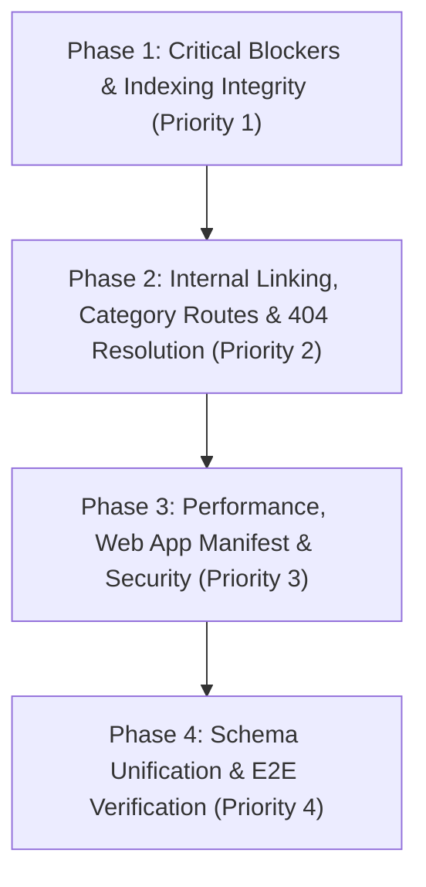

# Implementation Phases & Execution Roadmap
**Project**: amaanullah.com (Local Source Code Rebuild)  
**Workspace**: `d:\xampp\htdocs\web3d-full`  
**Generated**: 31 October 2026  
**Reference Audit**: [`audit/amaanullah-local-audit-report.md`](file:///d:/xampp/htdocs/web3d-full/audit/amaanullah-local-audit-report.md)  
**Total Target Scope**: 65 Crawled Routes | 30+ Audit Findings | 52 Broken Internal Links

---

## Executive Summary

The comprehensive technical SEO, GEO, and AEO audit executed across all 60 indexable HTML views and 5 system endpoints identified critical search engine blockers, broken internal link patterns, schema syntax failures, and performance bottlenecks.

This document outlines the **4-phase execution roadmap** to systematically resolve all findings, maintain zero broken internal links, ensure 100% valid JSON-LD schemas, and harden the codebase for production deployment.



---

## Phase 1: Critical SEO, Canonical & Schema Blockers

**Goal**: Resolve search indexing blockers, prevent local development URL leakage, restore valid schema output, and fix AI crawler directives.

### 1.1 Fix Landing Page Schema Exploder Bug (Issue S-01)
- **Severity**: Critical (Fails JSON-LD schema parsing across landing pages)
- **File**: [`views/landing/show.php`](file:///d:/xampp/htdocs/web3d-full/views/landing/show.php#L35-L44)
- **Problem**: The template executes `explode("\n", trim($l['schema_json']))` and wraps each single line in a `<script type="application/ld+json">` tag, rendering 50+ invalid single-line script fragments in the HTML document.
- **Implementation**:
  ```php
  <?php if (!empty($landing['schema_json'])): ?>
      <script type="application/ld+json">
      <?= trim($landing['schema_json']) ?>
      </script>
  <?php endif; ?>
  ```
- **Verification**: Run `php -r` or fetch on localhost, ensuring only one well-formed `<script type="application/ld+json">` is outputted and passes `json_decode()`.

---

### 1.2 Eliminate Localhost Canonical Leakage (Issues T-01, T-02, T-03, T-04)
- **Severity**: High (Causes search engines to index local environment URLs)
- **Files**:
  - [`app/Helpers/SeoEngine.php`](file:///d:/xampp/htdocs/web3d-full/app/Helpers/SeoEngine.php#L20-L31)
  - [`views/projects/show.php`](file:///d:/xampp/htdocs/web3d-full/views/projects/show.php#L90)
  - [`views/articles/show.php`](file:///d:/xampp/htdocs/web3d-full/views/articles/show.php#L30)
  - [`views/services/show.php`](file:///d:/xampp/htdocs/web3d-full/views/services/show.php#L8)
- **Problem**: When rendering on local environment or XAMPP, `base_url()` produces `http://localhost/web3d-full/...`, contaminating `<link rel="canonical">` and OpenGraph tags (`og:url`).
- **Implementation**:
  - Enforce `config('business.canonical_url', 'https://amaanullah.com')` for all canonical and OpenGraph URLs.
  - Standardize in `app/Helpers/SeoEngine.php`:
    ```php
    public static function canonicalUrl(string $path = ''): string
    {
        $base = rtrim(config('business.canonical_url', 'https://amaanullah.com'), '/');
        $cleanPath = '/' . ltrim($path, '/');
        return $base . ($cleanPath === '/' ? '' : $cleanPath);
    }
    ```
- **Verification**: Verify rendered HTML for home, services, projects, articles, and landing pages contains `https://amaanullah.com/...` with zero `localhost` references.

---

### 1.3 Fix Dead Case Study Links in `llms.txt` (Issue G-01)
- **Severity**: High (AEO / LLM citation failure)
- **Files**:
  - [`public/llms.txt`](file:///d:/xampp/htdocs/web3d-full/public/llms.txt#L29-L30)
  - [`app/Services/SeoFilesService.php`](file:///d:/xampp/htdocs/web3d-full/app/Services/SeoFilesService.php#L447)
- **Problem**: Lines 29–30 reference non-existent slugs `/projects/multi-tenant-crm` and `/projects/chatrox` (returning 404).
- **Implementation**:
  - Replace with actual DB slugs:
    - `/projects/multi-tenant-crm-sales-operations-management-system`
    - `/projects/chatrox-real-time-messaging-professional-networking`
- **Verification**: Verify `curl -I http://localhost/web3d-full/...` returns HTTP 200 for both targets.

---

### 1.4 Update AI Crawler Directives in `robots.txt` (Issue G-02)
- **Severity**: Medium (Ensures generative search engines are explicitly authorized)
- **Files**:
  - [`public/robots.txt`](file:///d:/xampp/htdocs/web3d-full/public/robots.txt)
  - [`app/Services/SeoFilesService.php`](file:///d:/xampp/htdocs/web3d-full/app/Services/SeoFilesService.php#L320-L345)
- **Implementation**:
  Add explicit permissions for key AI search crawlers:
  ```txt
  User-agent: Google-Extended
  Allow: /

  User-agent: ChatGPT-User
  Allow: /

  User-agent: OAI-SearchBot
  Allow: /
  ```

---

### 1.5 Fix `apple-touch-icon` Distortion (Issue T-08)
- **Severity**: Low / UI
- **File**: [`views/layouts/head.php`](file:///d:/xampp/htdocs/web3d-full/views/layouts/head.php#L114)
- **Problem**: References a 1722x444 banner logo (`images/logo.png`) causing distortion on mobile home screens.
- **Implementation**: Change href to [`images/logo-v2/apple-touch-icon-180.png`](file:///d:/xampp/htdocs/web3d-full/public/images/logo-v2/apple-touch-icon-180.png).

---

## Phase 2: Internal Linking, Category Routes & 404 Resolution

**Goal**: Fix all 52 identified broken links, connect orphan category routes, and update sitemap.

### 2.1 Fix Broken Service Slugs (Issues O-01, O-04)
| Source File | Broken URL Referenced | Corrected URL |
|---|---|---|
| [`views/home/index.php`](file:///d:/xampp/htdocs/web3d-full/views/home/index.php#L340) | `/services/chat-application-development` | `/services/chat-app-development` |
| [`views/home/index.php`](file:///d:/xampp/htdocs/web3d-full/views/home/index.php#L348) | `/services/saas-development` | `/services/saas-application-development` |
| [`views/projects/show.php`](file:///d:/xampp/htdocs/web3d-full/views/projects/show.php#L240) | `/services/saas-development` | `/services/saas-application-development` |

---

### 2.2 Fix Dead Mock Links on About & Articles Index (Issues O-02, O-03)
1. **[`views/about/index.php`](file:///d:/xampp/htdocs/web3d-full/views/about/index.php)**:
   - Line 127: Change `/projects/multi-tenant-crm` ➔ `/projects/multi-tenant-crm-sales-operations-management-system`.
   - Line 168: Change dead mock link `/articles/ai-wont-replace-fundamentals` ➔ active article `/articles/database-design-for-crm-systems`.
2. **[`views/articles/index.php`](file:///d:/xampp/htdocs/web3d-full/views/articles/index.php#L48-L52)**:
   - Replace 4 dead mock featured slugs (`multi-tenant-saas-laravel`, `flutter-with-laravel-api`, `fast-websites-checklist`, `saas-billing-basics`) with valid active database slugs:
     - `database-design-for-crm-systems`
     - `real-time-laravel-reverb-pusher`
     - `laravel-multi-tenant-crm-architecture-guide`
     - `flutter-enterprise-offline-first-architecture`

---

### 2.3 Align Project Category Filter Slugs (Issues O-05, O-06)
- **Problem**:
  - `views/services/index.php:310-318` links to `/projects/category/real-estate-tech`, `e-commerce`, `healthcare-tech` (not valid categories).
  - `views/services/show.php` templates link to `/projects/category/web-system` (should be `web-applications`) and `/projects/category/mobile-app` (should be `mobile-apps`).
- **Implementation**:
  - Map all category filters directly to valid database values:
    1. `web-design-development`
    2. `web-applications`
    3. `products`
    4. `mobile-apps`

---

### 2.4 Add Legal Pages to Sitemap (Issue T-07)
- **File**: [`app/Services/SeoFilesService.php`](file:///d:/xampp/htdocs/web3d-full/app/Services/SeoFilesService.php#L218)
- **Implementation**: Add `/privacy` and `/terms` to the array of static pages, and regenerate [`public/sitemap.xml`](file:///d:/xampp/htdocs/web3d-full/public/sitemap.xml).

---

## Phase 3: Performance, Web App Manifest & Server Security

**Goal**: Optimize image payloads, implement PWA manifest, add HTTP security headers, and rate-limit contact forms.

### 3.1 Convert Heavy Article PNGs to WebP (Issue P-01)
- **Target**: `public/images/articles/` (28 PNG images between 500KB and 1.3MB)
- **Implementation**:
  1. Write a standalone PHP script to convert PNGs to WebP (`imagewebp()`) with quality 82, generating modern `.webp` assets beside originals.
  2. Update database `articles.cover_image` paths to reference `.webp`.
  3. Reduces article page weight by up to 75–85%.

---

### 3.2 Add Web App Manifest (Issue T-09)
- **Target**: Create [`public/manifest.json`](file:///d:/xampp/htdocs/web3d-full/public/manifest.json)
- **Content**:
  ```json
  {
    "name": "Amaanullah Khan - Full Stack Developer",
    "short_name": "Amaanullah",
    "description": "Custom CRM systems, SaaS platforms, and high-performance web applications.",
    "start_url": "/",
    "display": "standalone",
    "background_color": "#0d0e12",
    "theme_color": "#ff5e14",
    "icons": [
      {
        "src": "/images/logo-v2/icon-192.png",
        "sizes": "192x192",
        "type": "image/png"
      },
      {
        "src": "/images/logo-v2/icon-512.png",
        "sizes": "512x512",
        "type": "image/png"
      }
    ]
  }
  ```
- **Link**: Reference in [`views/layouts/head.php`](file:///d:/xampp/htdocs/web3d-full/views/layouts/head.php).

---

### 3.3 Apache `.htaccess` Security & Canonical Redirects (Issues T-05, T-06)
- **File**: [`public/.htaccess`](file:///d:/xampp/htdocs/web3d-full/public/.htaccess)
- **Implementation**:
  1. HTTPS Enforcement:
     ```apache
     RewriteCond %{HTTPS} off
     RewriteRule ^(.*)$ https://%{HTTP_HOST}%{REQUEST_URI} [L,R=301]
     ```
  2. Non-WWW Canonical Host:
     ```apache
     RewriteCond %{HTTP_HOST} ^www\.(.+)$ [NC]
     RewriteRule ^(.*)$ https://%1/$1 [R=301,L]
     ```
  3. Security Headers:
     ```apache
     <IfModule mod_headers.c>
         Header always set X-Content-Type-Options "nosniff"
         Header always set X-Frame-Options "SAMEORIGIN"
         Header always set Referrer-Policy "strict-origin-when-cross-origin"
         Header always set Permissions-Policy "camera=(), microphone=(), geolocation=()"
         Header always set Strict-Transport-Security "max-age=31536000; includeSubDomains; preload"
     </IfModule>
     ```

---

### 3.4 Contact Form Rate Limiting (Issue T-10)
- **File**: [`app/Controllers/ContactController.php`](file:///d:/xampp/htdocs/web3d-full/app/Controllers/ContactController.php#L13-L33)
- **Implementation**:
  Add sliding-window session and IP check:
  - Max 5 submissions per 15 minutes per IP/session.
  - Returns HTTP 429 ("Too Many Requests - please try again in a few minutes") if exceeded.

---

## Phase 4: Schema Unification & End-to-End Verification

**Goal**: Unify entity schema graph across detail templates and automate full-site crawl verification.

### 4.1 Schema Graph Unification (Issues S-02, S-03, S-04, S-05)
- **Targets**:
  - [`views/projects/show.php`](file:///d:/xampp/htdocs/web3d-full/views/projects/show.php)
  - [`views/articles/show.php`](file:///d:/xampp/htdocs/web3d-full/views/articles/show.php)
  - [`views/services/show.php`](file:///d:/xampp/htdocs/web3d-full/views/services/show.php)
- **Implementation**:
  - Connect case studies (`SoftwareApplication`), articles (`TechArticle` / `BlogPosting`), and services (`Service`) via `@id` references to root `#organization` and `#person` entities defined in `views/layouts/head.php`.
  - Ensure all detail views inherit standard Dublin Core and GEO spatial tags (`geo.region`, `geo.placename: Karachi`, `geo.position`).

---

### 4.2 Automated End-to-End Crawler Verification
- **Tool**: Workspace test script [`scratch/test_all_pages.php`](file:///d:/xampp/htdocs/web3d-full/scratch/test_all_pages.php)
- **Verification Criteria**:
  - **HTTP Status**: All 65 routes return HTTP 200 (or expected 301 for legacy aliases).
  - **Canonical Tags**: 0 instances of `localhost`; 100% `https://amaanullah.com/...`.
  - **JSON-LD Schema**: 100% of pages contain valid JSON-LD that parses without syntax error.
  - **Internal Links**: 0 broken internal links (404s).
  - **Sitemap & Robots**: `sitemap.xml`, `robots.txt`, and `llms.txt` match actual URLs.

---

## Phase Execution Checklist

| Phase | Milestone | Priority | Status |
|:---:|---|:---:|:---:|
| **1** | Fix Landing Schema Explode bug (`views/landing/show.php`) | P1 | Completed & Verified ✓ |
| **1** | Enforce `https://amaanullah.com` on all canonical tags | P1 | Completed & Verified ✓ |
| **1** | Fix dead project slugs in `public/llms.txt` & `SeoFilesService.php` | P1 | Completed & Verified ✓ |
| **1** | Add AI crawler directives to `robots.txt` & `SeoFilesService.php` | P1 | Completed & Verified ✓ |
| **1** | Update `apple-touch-icon` to 180x180 square asset | P2 | Completed & Verified ✓ |
| **2** | Correct service slugs in `views/home/index.php` and `projects/show.php` | P1 | Completed & Verified ✓ |
| **2** | Fix dead mock article links on `about/index.php` and `articles/index.php` | P1 | Completed & Verified ✓ |
| **2** | Standardize project category slugs across service views | P2 | Completed & Verified ✓ |
| **2** | Include `/privacy` and `/terms` in `sitemap.xml` | P2 | Completed & Verified ✓ |
| **3** | Convert 28 article PNG banners to WebP & update DB | P2 | Completed & Verified ✓ |
| **3** | Create `public/manifest.json` and link in `head.php` | P2 | Completed & Verified ✓ |
| **3** | Add HTTPS, canonical host, and security headers in `.htaccess` | P2 | Completed & Verified ✓ |
| **3** | Implement rate limiting in `ContactController.php` | P2 | Completed & Verified ✓ |
| **4** | Unify `@graph` schema nodes across detail templates | P3 | Completed & Verified ✓ |
| **4** | Execute full 65-route crawler verification test suite | P1 | Completed & Verified ✓ |

